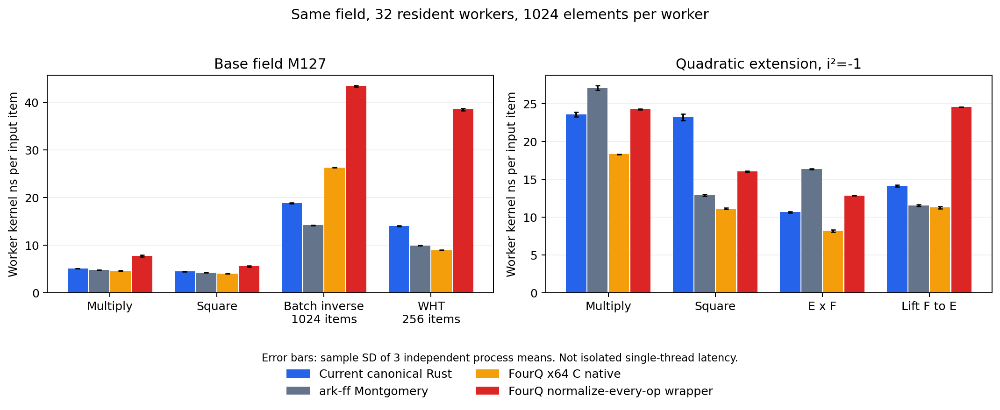

# 三方微基准结论与当前后续范围

自研实现并非全面慢于参照库；扩域平方、部分批量求逆和小工作集WHT存在可测短板。不同工作集/操作会改变排序，不能凭单个inverse或平方推断完整PCS收益。12进程、8280窗口与四张数值表的纯归档重建均通过，Architect独立复核82c55673通过。



图为32个并发工作者、每人1024元素的线程内核计时；误差线是三轮独立进程均值的样本标准差，不是置信区间或独占单线程延迟。

**FourQ逐项规范化是本次实际测量的保守包装，不是最优可替换成本界。** 某些操作的额外归一化可能可省，不能把包装开销全归因于FourQ原生算法；原生冗余表示仍需在实际Eq/Hash/编码等边界正确处理。共同prefix批逆的差距也不能全部归因于单次inverse。

Jal1n后续指示ae4b0be0要求直接接入ark-ff/FourQ原生做PCS代表点对照：本轮下一步仅M127 μ=20/26、r=2、c=4、QA/RS四点，保持同一一次性内存生命周期及32线程，暂不展开全参数重跑，也不先修改自研算术。微基准尚不能选出端到端PCS优胜后端。

完整窗口表使用无损压缩下载：[raw-windows.csv.gz](raw-windows.csv.gz)。原始逐进程CSV和源码也保留在[原始证据归档](raw-evidence.tar.gz)。解压后可与归档重建的四张数值表逐字节比对。

---

# M127 exact-field arithmetic comparison

12 independent processes / 8280 windows validated. All timings use32threads. Arithmetic source hash: `26c423cde3de04c362fe1d08e0747e410c506c5f4bcc34cd1297f8f9f174e576`.

Timing schema2 uses32resident OS workers synchronized before each window. Workers repeat local kernel batches for at least100ms each; calibration/warmup finish before the measured start. Hashes/CSV/result collection are after all timed workers finish. Worker clocks are amortized across calibrated blocks targeting1ms. The wall clock includes start/end synchronization once per window. Full-width seeded fold challenges are converted before timing and included in the input fingerprint. The process is restricted to the recorded32distinct physical cores; this grants no exclusive use of those cores.

Numbers below are wall nanoseconds per **input item**, inclusive of synchronization (or legacy dispatch for schema1). Scalar arithmetic has one operation per item; composite kernels have multiple operations. Per-worker kernel costs, raw thread counters, process/window standard deviations and matched-round ratios are separate CSV columns. Worker elapsed costs include scheduling effects and are not isolated single-thread latency. A ratio above1 means our cost is higher.

Largest working set: 1048576 total elements.

| Degree | Kernel | Ours ns/item | Ark ns/item | FourQ native ns/item | FourQ canonical ns/item |
|---|---|---:|---:|---:|---:|
| 1 | Add | 0.067 | 0.059 | 0.050 | 0.129 |
| 1 | BatchInverse | 0.605 | 0.460 | 0.837 | 1.384 |
| 1 | BatchInverse4096 | 0.573 | 0.449 | 0.810 | 1.358 |
| 1 | BatchInverseAlloc | 0.604 | 0.464 | 0.834 | 1.404 |
| 1 | CanonicalRoundtrip | 0.052 | 0.158 | 0.078 | 0.078 |
| 1 | ChainMul | 0.218 | 0.162 | 0.270 | 0.542 |
| 1 | ChainSquare | 0.210 | 0.163 | 0.360 | 0.616 |
| 1 | Copy | 0.013 | 0.013 | 0.017 | 0.017 |
| 1 | Decode | 0.069 | 0.470 | 0.016 | 0.016 |
| 1 | Dot | 0.191 | 0.165 | 0.167 | 0.503 |
| 1 | DotMixed | 0.191 | 0.163 | 0.157 | 0.502 |
| 1 | Encode | 0.020 | 0.088 | 0.077 | 0.076 |
| 1 | Fold | 0.239 | 0.232 | 0.262 | 0.537 |
| 1 | Halve | 0.037 | 0.072 | 0.014 | 0.120 |
| 1 | Inverse | 39.982 | 43.997 | 39.924 | 37.773 |
| 1 | LiftFold | 0.241 | 0.233 | 0.260 | 0.543 |
| 1 | Mixed | 0.164 | 0.155 | 0.154 | 0.261 |
| 1 | Mul | 0.164 | 0.156 | 0.154 | 0.263 |
| 1 | Neg | 0.027 | 0.032 | 0.063 | 0.128 |
| 1 | Square | 0.145 | 0.137 | 0.127 | 0.185 |
| 1 | Sub | 0.046 | 0.052 | 0.049 | 0.131 |
| 1 | Sumcheck | 0.370 | 0.659 | 0.470 | 1.025 |
| 1 | Wht | 0.453 | 1.321 | 0.288 | 1.204 |
| 2 | Add | 0.284 | 0.251 | 0.208 | 0.363 |
| 2 | BatchInverse | 3.017 | 4.093 | 2.215 | 2.830 |
| 2 | BatchInverse4096 | 3.012 | 4.045 | 2.198 | 2.741 |
| 2 | BatchInverseAlloc | 3.040 | 4.100 | 2.277 | 2.827 |
| 2 | CanonicalRoundtrip | 0.109 | 0.863 | 0.155 | 0.155 |
| 2 | ChainMul | 0.713 | 1.232 | 1.015 | 1.152 |
| 2 | ChainSquare | 1.118 | 0.701 | 0.770 | 0.923 |
| 2 | Copy | 0.582 | 0.586 | 0.034 | 0.034 |
| 2 | Decode | 0.098 | 0.983 | 0.034 | 0.034 |
| 2 | Dot | 0.824 | 1.598 | 0.653 | 0.980 |
| 2 | DotMixed | 0.391 | 0.672 | 0.481 | 0.684 |
| 2 | Encode | 0.060 | 0.281 | 0.154 | 0.153 |
| 2 | Fold | 0.920 | 1.893 | 0.754 | 1.252 |
| 2 | Halve | 0.083 | 0.149 | 0.045 | 0.227 |
| 2 | Inverse | 42.715 | 44.752 | 38.494 | 41.003 |
| 2 | LiftFold | 0.484 | 0.545 | 0.464 | 0.799 |
| 2 | Mixed | 0.456 | 0.533 | 0.414 | 0.473 |
| 2 | Mul | 0.768 | 1.276 | 0.600 | 0.791 |
| 2 | Neg | 0.077 | 0.058 | 0.132 | 0.250 |
| 2 | Square | 0.753 | 0.727 | 0.354 | 0.533 |
| 2 | Sub | 0.240 | 0.239 | 0.210 | 0.362 |
| 2 | Sumcheck | 1.469 | 2.834 | 1.291 | 2.082 |
| 2 | Wht | 1.427 | 2.834 | 2.155 | 1.741 |

The unchanged custom canonical field, generic ark-ff0.6.0 Montgomery field and pinned FourQ x64 C field all use p=2^127−1 and extension X²+1. FourQ is no longer maintained. No ASM/AVX FourQ macros are selected. ark's asm feature does not activate its excluded no-carry M127 multiplication branch. Native FourQ allows redundant zero; canonical FourQ normalizes each returned field operation. Cross-language calls carry whole worker batches, not individual field operations. Canonical exports and initialization are outside arithmetic windows; Encode/Decode/CanonicalRoundtrip measure those boundaries separately. Copy is a dispatch/memory control, not a guaranteed quantity to subtract.

Current custom arithmetic was not optimized for this baseline. Three process rounds and five windows per process, when present, are distinct levels of repetition; windows are not independent processes. No single aggregate score across unrelated kernels is meaningful. Large-workset costs may include memory bandwidth; small-workset wall costs may be dominated by scheduling. Both remain in the evidence rather than selecting only favorable sizes. These arithmetic kernels do not themselves measure a complete PCS, establish constant-time behavior or prove cryptographic security. Batch inverse is a common chunked prefix algorithm, with a separately tagged allocation-inclusive variant. Full lifecycle PCS checks are needed before attributing end-to-end speedup. The latest follow-up is limited to the four representative configurations described above; no full sweep is currently scheduled.

The archive contains every command, exit/resource record, window, source copy and pinned version/hash; only the executable is omitted. Frozen source uses the recorded root commit and local Plonky3 pin. Build instructions and exact semantics are in data/source/README.md after extracting the archive. No host kernel/swap/cgroup/frequency changes were made. Affinity and shared-host limitations are recorded.

Archive-only numeric reproduction:

```sh
mkdir evidence
tar -xzf raw-evidence.tar.gz -C evidence
python3 analyze.py --root evidence/data --output regenerated
```

First decompress raw-windows.csv.gz, then compare the four numeric CSVs byte-for-byte; checksums cover the published snapshot. Recreate the figure with python3 plot.py (matplotlib required).
