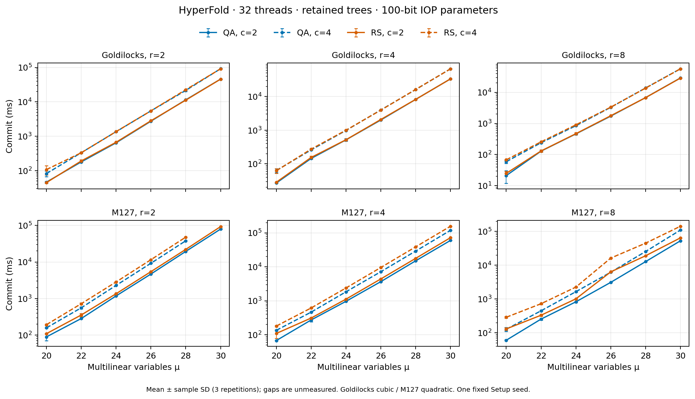
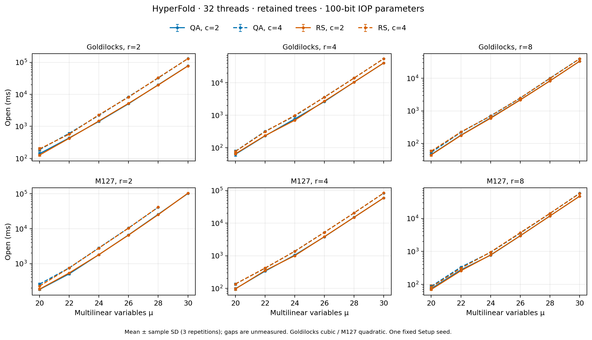
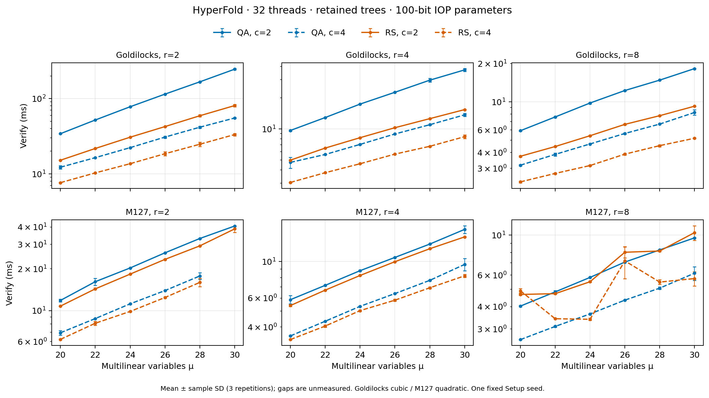
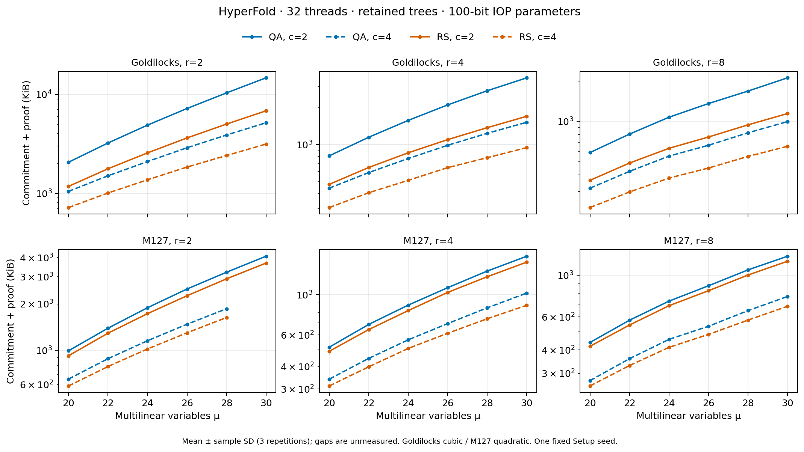

# HyperFold retained-memory experiment report

Validated 144 configurations: 142 measured, 0 active memory-guard stops, 2 process failures; 426 completed raw samples. No recomputation was used.

Each measured configuration used 32 Rayon threads, one warmup and three measured repetitions. Commit/open/verify means exclude Setup and final serialization. Proof size includes the commitment and evaluation proof, including wire framing. `raw-samples.csv` contains every completed repetition; `results.csv` adds sample standard deviations and observed peak RSS.

The two largest M127 configurations were actually attempted with retained trees, bypassing the estimate ceiling. Programmatic memory termination was disabled for this follow-up. Incomplete aggregate measurements are blank; partial samples, real exit codes and memory observations are retained. A guard stop, a process exit/signal, and an OS-confirmed OOM are distinct outcomes. A SIGKILL alone does not establish an OOM; global OOM-counter changes are supporting host observations, not process-specific attribution.

Maximum recorded RSS: 498.044 GiB at M127 / Rs / 30 / 2 / 4. Resource usage spans the actual process lifetime, including Setup or warmup that executed.

## Reproduction and limits

Pinned executable SHA-256: `2b2df0a76f29b1746174eb3280998dc7e7bf6c709e6715faf4554e9a0800906e`. Source at policy migration: `102a4ffd98ccb1a58aad0f5150dc97d423820500`; the original binary-build provenance is preserved in `reused-source-manifest.json`. Plonky3 commit `0d803737b681774186cd283b1fd2d8e493655c82`; AMD EPYC 9754, 503 GiB host RAM, Rust/Cargo 1.95.0, native CPU flags. Commands, seeds, hardware and per-case raw/resource records are in the manifest and evidence archive.

Parameters use the 144 official uniform-profile rows, Goldilocks cubic and M127 quadratic, certificate `hfc-tight-total100-gold-m127-v3-2026-11-05`. The stated 100-bit bound concerns the specified interactive IOP/commit-binding budget. Correctness tests and these measurements are not a security proof of the implementation, Fiat–Shamir, Merkle or seeded Setup.

This is one machine and one Setup seed, with three repetitions, no CPU pinning and shared host/NUMA scheduling. Encoder contracts differ: Goldilocks RS uses coefficient FFT encoding; M127 RS uses systematic Lagrange encoding. Compare QA/RS at matched field, μ, r and c.

### Regenerate tables and figures

Requires Python 3.11+ and Matplotlib (here 3.10.6). Run from this report folder. Parameter CSV hashes are verified; no prover executable is required for archived data analysis.

```sh
mkdir evidence
tar -xzf raw-evidence.tar.gz -C evidence
python3 analyze_hyperfold.py --root evidence --parameter-dir parameters --output regenerated
```

## Figures









## Matched QA/RS comparisons

The table gives the median QA/RS ratio across matched field/μ/r/c settings. Below 1 means less time or fewer bytes for QA. These are descriptive ratios over this experiment matrix, not population estimates. Query counts differ by the certified base-code distance bounds; verification and proof-size ratios include that effect.

| Field | Matched pairs | Commit | Open | Verify | Total bytes |
|---|---:|---:|---:|---:|---:|
| Goldilocks | 36 | 0.989 | 1.005 | 1.674 | 1.628 |
| M127 | 35 | 0.773 | 1.000 | 1.070 | 1.093 |

## Actual extreme-case attempts

| Case | Start UTC | Finish UTC | Sampled HWM GiB | Minimum available GiB | Exit code | Stop reason | Global OOM-count delta |
|---|---|---|---:|---:|---:|---|---:|
| M127-Qa-30-2-4 | 2026-11-06T05:48:20.543444+00:00 | 2026-11-06T05:55:35.602572+00:00 | 497.514839 | 0.000000 | 137 | process_exit | 1 |
| M127-Rs-30-2-4 | 2026-11-06T05:55:35.621465+00:00 | 2026-11-06T06:03:20.527788+00:00 | 498.050941 | 0.000000 | 137 | process_exit | 1 |

## μ=30 configurations

| Field | Backend | r | c | Status | Commit ms | Open ms | Verify ms | Total bytes | Peak GiB |
|---|---|---:|---:|---|---:|---:|---:|---:|---:|
| Goldilocks | Qa | 2 | 2 | measured | 45767.956030 | 77180.004453 | 245.239789 | 15102572 | 231.937214 |
| Goldilocks | Rs | 2 | 2 | measured | 45715.579188 | 76670.086491 | 80.606284 | 7001427 | 231.934555 |
| Goldilocks | Qa | 2 | 4 | measured | 91701.759328 | 130757.133245 | 55.124113 | 5300334 | 455.921528 |
| Goldilocks | Rs | 2 | 4 | measured | 91223.197157 | 129620.699708 | 33.224728 | 3226957 | 455.914162 |
| Goldilocks | Qa | 4 | 2 | measured | 33306.624302 | 40987.422231 | 37.151297 | 3609813 | 124.157555 |
| Goldilocks | Rs | 4 | 2 | measured | 33345.518437 | 41296.239234 | 15.351707 | 1747401 | 124.132717 |
| Goldilocks | Qa | 4 | 4 | measured | 66374.728958 | 55839.758086 | 13.661887 | 1560858 | 221.286686 |
| Goldilocks | Rs | 4 | 4 | measured | 66070.302364 | 55775.992764 | 8.402609 | 967515 | 221.257828 |
| Goldilocks | Qa | 8 | 2 | measured | 28943.376700 | 33226.159181 | 18.215180 | 2161888 | 107.991714 |
| Goldilocks | Rs | 8 | 2 | measured | 28664.259822 | 33444.520375 | 9.229431 | 1171648 | 108.035099 |
| Goldilocks | Qa | 8 | 4 | measured | 56927.512126 | 39732.315686 | 8.238731 | 1020841 | 172.025173 |
| Goldilocks | Rs | 8 | 4 | measured | 56793.911712 | 39743.802655 | 5.168550 | 668133 | 171.977711 |
| M127 | Qa | 2 | 2 | measured | 79659.584242 | 101553.475494 | 40.662538 | 4180620 | 303.958836 |
| M127 | Rs | 2 | 2 | measured | 93008.527657 | 103181.190104 | 38.762164 | 3773058 | 303.960213 |
| M127 | Qa | 2 | 4 | runtime_failed |  |  |  |  | 497.514706 |
| M127 | Rs | 2 | 4 | runtime_failed |  |  |  |  | 498.044403 |
| M127 | Qa | 4 | 2 | measured | 59869.629895 | 59510.099437 | 15.707722 | 1676879 | 192.049885 |
| M127 | Rs | 4 | 2 | measured | 72091.655502 | 59709.562796 | 14.138788 | 1555171 | 192.162472 |
| M127 | Qa | 4 | 4 | measured | 118725.345187 | 83759.303523 | 9.613642 | 1047028 | 336.041721 |
| M127 | Rs | 4 | 4 | measured | 156512.662457 | 84031.135577 | 8.189272 | 895894 | 336.074570 |
| M127 | Qa | 8 | 2 | measured | 52722.676249 | 47297.587256 | 9.655784 | 1291461 | 176.049938 |
| M127 | Rs | 8 | 2 | measured | 64409.492136 | 47292.853363 | 10.329797 | 1214732 | 175.999084 |
| M127 | Qa | 8 | 4 | measured | 109657.640939 | 58235.432588 | 6.139102 | 788602 | 288.036812 |
| M127 | Rs | 8 | 4 | measured | 142141.199546 | 57285.289144 | 5.732357 | 699493 | 288.043385 |
